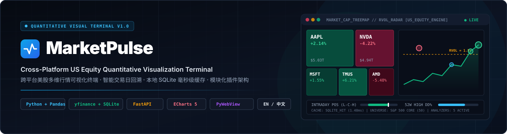
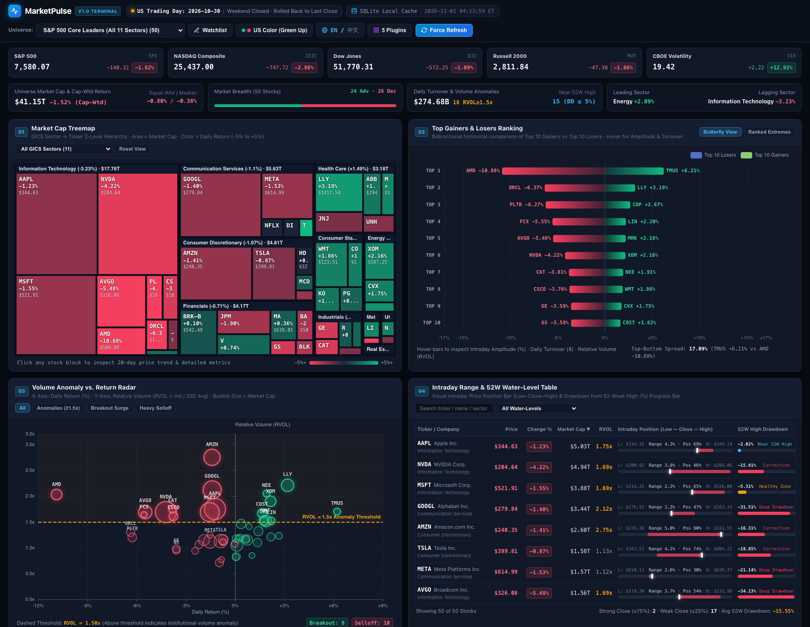
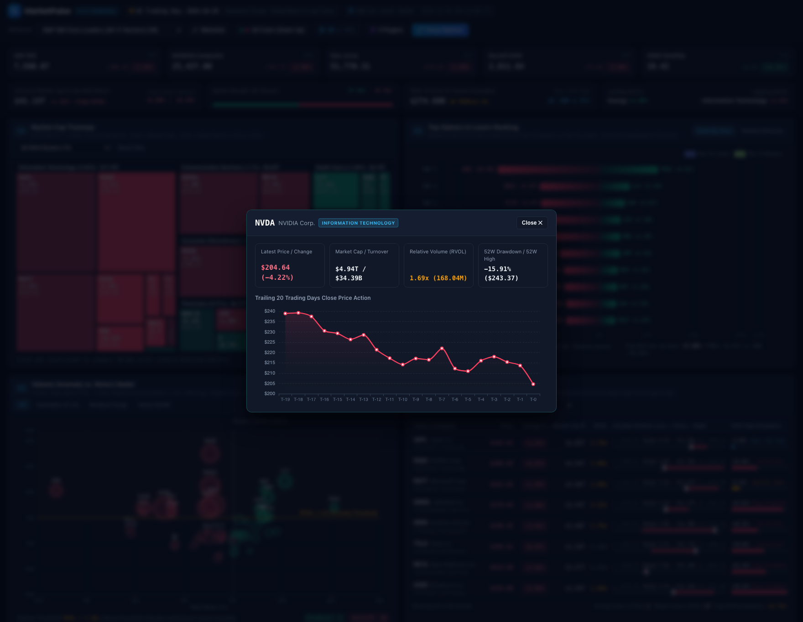
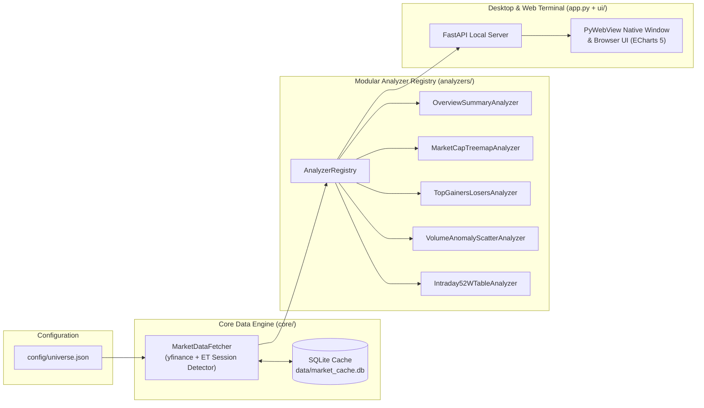

<div align="center">



# MarketPulse

**A Cross-Platform US Equity Quantitative Visualization Terminal**

[](https://www.python.org/)
[](https://fastapi.tiangolo.com/)
[](https://echarts.apache.org/)
[](https://pywebview.flowrl.com/)
[](https://www.sqlite.org/)
[](LICENSE)

<h3>
  <strong>English</strong> &nbsp;|&nbsp; <a href="README_CN.md">简体中文</a>
</h3>

</div>

---

## Overview

**MarketPulse** is an institutional-grade, local cross-platform desktop financial terminal built for quantitative researchers, equity analysts, and active traders. Powered by **Python (`yfinance` + `pandas` + `SQLite`)**, **FastAPI**, **Apache ECharts 5**, and **PyWebView**, it automatically detects the latest US stock market trading session and renders a high-density, multi-dimensional visual dashboard without requiring paid API keys.

Designed with a **modular plugin architecture (`analyzers/`)**, MarketPulse separates market data ingestion and caching from quantitative computation, allowing seamless expansion into historical drawdown backtesting, ETF fund flows, and volatility surface analytics.

---

## Interface Preview (English UI)

### 1. Main Quantitative Terminal Dashboard
> Full 4-widget terminal view featuring the Top Control Bar, US Core Index Ribbon (`SPX`, `IXIC`, `DJI`, `RUT`, `VIX`), Market Breadth & KPI Strip, Market Cap Treemap, Top Gainers & Losers Butterfly Chart, Volume Anomaly vs. Return Radar, and Intraday & 52W Water-Level Table.



### 2. Interactive 20-Day Price Action & Ticker Inspector
> Clicking any stock block in the Treemap, bar in the Ranking Chart, bubble in the Volume Scatter, or row in the Water-Level Table opens a dedicated modal with trailing 20-day close price action and multi-dimensional metrics.



---

## Key Features

### 1. Smart Trading Day Detection & Local SQLite Cache (`core/`)
- **Session-Aware Rollback (`America/New_York` ET)**: Automatically detects whether the US equity market is currently in **Live Intraday (`09:30–16:00 ET`)**, **Pre-Market**, **After-Hours**, **Weekend**, or **Market Holiday**. During non-trading hours, it automatically rolls back to the most recent completed trading day's closing snapshot and annotates the exact session status and timestamp in the top bar.
- **Zero-Rate-Limit SQLite Persistence (`data/market_cache.db`)**: Market snapshots are indexed by `(trading_date, ticker)`. Switching between universes or restarting the app on the same trading day serves data from local SQLite in **`< 2ms`**, completely avoiding Yahoo Finance rate limits while still supporting on-demand **Force Refresh**.
- **Built-in Configurable Universes (`config/universe.json`)**:
  - **S&P 500 Core Leaders (50 tickers)**: Flagship constituents across all 11 GICS sectors.
  - **NASDAQ-100 Core Tech & Growth (22 tickers)**: Semiconductors, AI infrastructure, cloud, and biotech leaders.
  - **Mega-Cap Tech & AI (16 tickers)**: Magnificent 7 and core AI compute equities.
  - **Custom Watchlist (Alpha Pool)**: Directly editable from the in-app Watchlist Editor modal.

### 2. Four Core Visual Widgets (`analyzers/` + `ui/`)

| # | Widget Name | Analyzer Module | Visual & Quantitative Design |
| :-: | :--- | :--- | :--- |
| **01** | **Market Cap Treemap** | `MarketCapTreemapAnalyzer` | Two-level nested hierarchy (`GICS Sector -> Stock Ticker`). Rectangle area strictly maps to **Market Cap ($)**; color intensity smoothly interpolates **Daily Return (%)** across `[-5%, +5%]`. Each block displays `Ticker + Change% + $Price` inside and supports sector filtering. |
| **02** | **Top Gainers & Losers** | `TopGainersLosersAnalyzer` | Bidirectional horizontal bar chart contrasting **Top 10 Gainers** vs. **Top 10 Losers** on a unified axis (switchable between *Butterfly View* and *Ranked Extremes*). Hovering reveals **Intraday Amplitude (%)**, **Daily Turnover ($)**, and **RVOL**. |
| **03** | **Volume Anomaly vs. Return Radar** | `VolumeAnomalyScatterAnalyzer` | Scatter plot mapping **X = Daily Return (%)**, **Y = Relative Volume (`RVOL = Volume / 20D Avg Volume`)**, and **Bubble Size = Market Cap**. Includes a dashed `RVOL = 1.5x` anomaly threshold line and quadrant filters to isolate **Breakout Surges** and **Heavy Selloffs**. |
| **04** | **Intraday Range & 52W Water-Level Table** | `Intraday52WTableAnalyzer` | High-density interactive table with search, regime filtering, and multi-column sorting. Features a visual **Intraday Price Position Bar (`Low — Close — High`)** and a **52-Week High Drawdown (`Drawdown %`) Progress Bar** with regime classification (`Near 52W High`, `Healthy Zone`, `Correction`, `Deep Drawdown`). |

### 3. Terminal UX & Bilingual / Dual-Theme Controls
- **Instant Bilingual Switching (`EN / 中文`)**: Every label, chart axis, tooltip, sector name, company name, and modal supports one-click toggling between **English** and **Simplified Chinese**.
- **Color Habit Switching (`US Color` vs. `CN Color`)**: One-click toggle between **US Market Convention (Green Up / Red Down)** and **CN Market Convention (Red Up / Green Down)**, immediately re-coloring all ECharts instances, badges, and progress bars.
- **Zero External CDN Dependency**: Bundles Apache ECharts 5 locally (`ui/static/vendor/echarts.min.js`) so the terminal renders instantaneously even in offline or restricted network environments.

---

## Core Quantitative Metrics

For every constituent ticker $i$ on trading day $t$, the data engine computes:

$$\text{Return}_i (\%) = \frac{P_{i,t}^{\text{close}} - P_{i,t-1}^{\text{close}}}{P_{i,t-1}^{\text{close}}} \times 100, \qquad \text{RVOL}_i = \frac{V_{i,t}}{\frac{1}{20}\sum_{k=1}^{20} V_{i,t-k}}$$

$$\text{Intraday Position}_i (\%) = \frac{P_{i,t}^{\text{close}} - P_{i,t}^{\text{low}}}{P_{i,t}^{\text{high}} - P_{i,t}^{\text{low}}} \times 100, \qquad \text{52W Drawdown}_i (\%) = \frac{P_{i,t}^{\text{close}} - \max_{\tau \in [t-251, t]} P_{i,\tau}^{\text{high}}}{\max_{\tau \in [t-251, t]} P_{i,\tau}^{\text{high}}} \times 100$$

---

## System Architecture & Directory Structure



```text
market-pulse/
├── app.py                          # FastAPI backend server & PyWebView native desktop launcher
├── requirements.txt                # Python package dependencies
├── README.md                       # English documentation (Default)
├── README_CN.md                    # Simplified Chinese documentation
├── config/
│   └── universe.json               # GICS sector definitions, US indices & 4 stock universes
├── core/
│   ├── __init__.py
│   ├── cache.py                    # SQLite local persistence engine (data/market_cache.db)
│   └── data_fetcher.py             # Smart US trading day detector & concurrent yfinance fetcher
├── analyzers/
│   ├── __init__.py                 # Auto-discovery & registration of analyzer plugins
│   ├── base.py                     # BaseAnalyzer abstract class & AnalyzerRegistry
│   ├── overview_summary.py         # Market breadth, cap-weighted returns & sector ranking
│   ├── treemap_analyzer.py         # Widget 01: Market Cap Treemap hierarchy builder
│   ├── gainers_losers_analyzer.py  # Widget 02: Top 10 Gainers & Losers ranking analyzer
│   ├── volume_anomaly_analyzer.py  # Widget 03: RVOL vs. Return anomaly scatter analyzer
│   └── intraday_52w_analyzer.py    # Widget 04: Intraday position & 52W drawdown analyzer
├── ui/
│   ├── index.html                  # Dark mode financial terminal layout
│   └── static/
│       ├── css/terminal.css        # Responsive grid & US/CN dual color theme variables
│       ├── js/app.js               # Bilingual i18n controller & ECharts 5 widget renderers
│       └── vendor/echarts.min.js   # Local Apache ECharts 5 bundle
├── docs/
│   └── assets/                     # Project banner & bilingual interface screenshots
└── tests/
    └── verify_data_engine.py       # Automated verification script for data engine & analyzers
```

---

## Quick Start

### 1. Environment Setup

```bash
# Clone the repository
git clone https://github.com/lpeixin/market-pulse.git
cd market-pulse

# Create and activate virtual environment
python3 -m venv .venv
source .venv/bin/activate   # Windows: .venv\Scripts\activate

# Install dependencies
pip install --upgrade pip
pip install -r requirements.txt
```

### 2. Verify Data Engine & Local Cache

```bash
python tests/verify_data_engine.py
```

### 3. Launch MarketPulse

```bash
# Mode 1 (Default): Launch Native Cross-Platform Desktop Window (PyWebView)
python app.py

# Mode 2: Launch Local Server and Open in Default Web Browser (http://127.0.0.1:8765)
python app.py --browser

# Mode 3: Run Headless FastAPI Server Only
python app.py --server-only --port 8765
```

---

## Extending with Custom Analyzer Plugins

To add a new quantitative panel (e.g., *Historical Max Drawdown*, *ETF Fund Flows*, or *Volatility Regime*), create a new file in `analyzers/` and decorate your class with `@AnalyzerRegistry.register`:

```python
from typing import Any, Dict, List
import pandas as pd
from analyzers.base import AnalyzerRegistry, BaseAnalyzer

@AnalyzerRegistry.register
class VolatilityRegimeAnalyzer(BaseAnalyzer):
    plugin_id = "volatility_regime"
    plugin_name_en = "Intraday Volatility Regime"
    plugin_name_zh = "日内波动率状态分析"
    plugin_description_en = "Analyzes cross-sectional intraday amplitude dispersion"
    plugin_description_zh = "分析截面日内振幅离散度与波动率分位"
    version = "1.0.0"

    def analyze(self, df: pd.DataFrame, records: List[Dict[str, Any]]) -> Dict[str, Any]:
        return {
            "mean_amplitude_pct": round(float(df["intraday_range_pct"].mean()), 2),
            "max_amplitude_ticker": df.loc[df["intraday_range_pct"].idxmax(), "ticker"],
        }
```

Once imported in `analyzers/__init__.py`, its output is automatically included under `widgets["volatility_regime"]` in the `/api/dashboard` JSON response.

---

## License

Released under the [MIT License](LICENSE).
