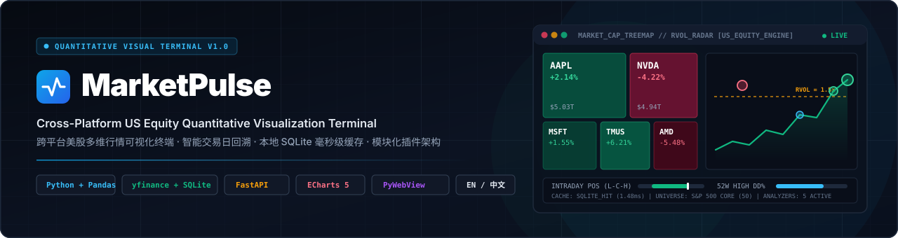
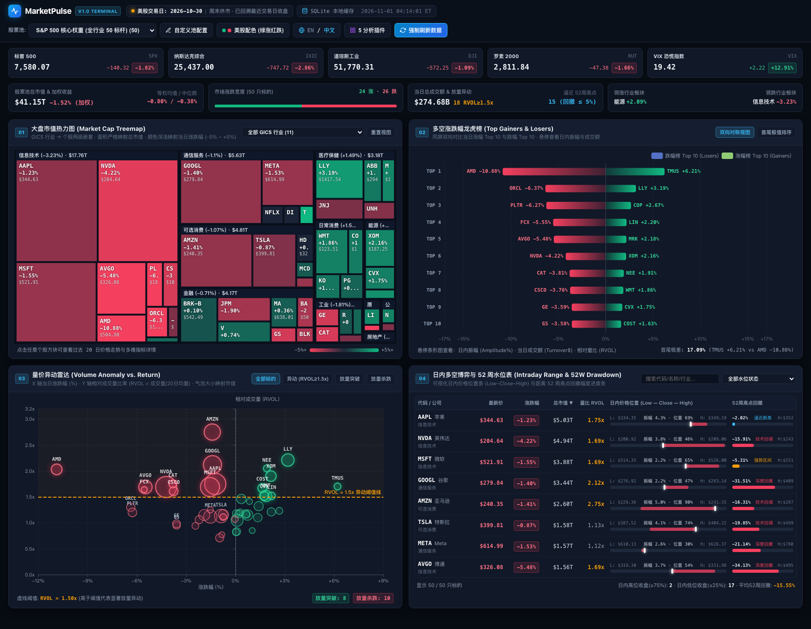
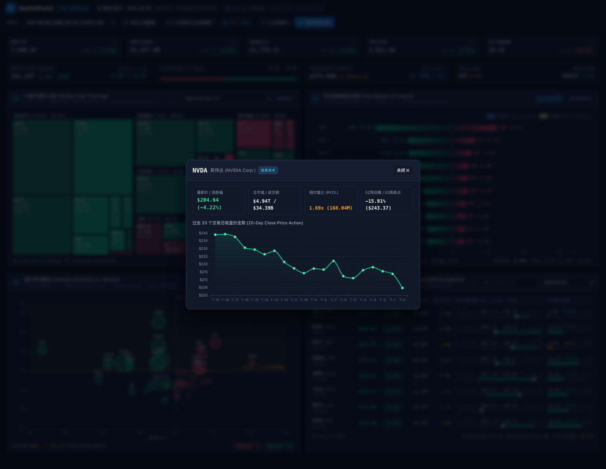
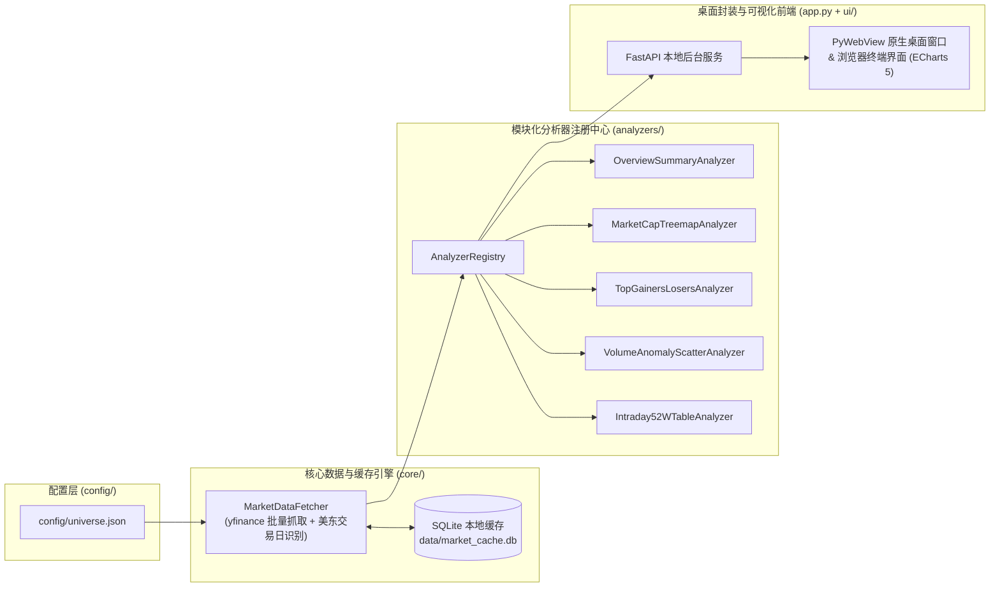

<div align="center">



# MarketPulse

**跨平台美股多维量化行情可视化终端**

[](https://www.python.org/)
[](https://fastapi.tiangolo.com/)
[](https://echarts.apache.org/)
[](https://pywebview.flowrl.com/)
[](https://www.sqlite.org/)
[](LICENSE)

<h3>
  <a href="README.md">English</a> &nbsp;|&nbsp; <strong>简体中文</strong>
</h3>

</div>

---

## 项目简介

**MarketPulse** 是一款面向金融数据工程、量化研究与美股交易者的本地跨平台桌面行情可视化终端。项目基于 **Python (`yfinance` + `pandas` + `SQLite`) + FastAPI + Apache ECharts 5 + PyWebView** 构建，无需任何付费 API Key 即可稳定拉取美股核心指数与代表性权重股行情，并在现代暗黑金融终端（Dark Mode Financial Terminal）界面中生成高交互、多维度的可视化看板。

项目采用高内聚、低耦合的**模块化插件架构（`analyzers/`）**，将数据拉取/本地缓存层与量化指标计算层彻底解耦，方便后续无缝扩展“历史最大回撤对比”、“ETF 资金流向监控”、“波动率曲面分析”等新量化模块。

---

## 软件界面截图（中文界面）

### 1. 多维量化终端全景看板
> 完整呈现顶部智能交易日状态栏、美股五大核心指数横幅（标普 500、纳斯达克、道琼斯、罗素 2000、VIX 恐慌指数）、全市场宽度与 KPI 指标条，以及四大核心可视化视图（大盘市值热力图、多空涨跌幅龙虎榜、量价异动雷达、日内多空博弈与 52 周水位表）。



### 2. 个股 20 日价格走势与多维指标详情弹窗（支持红涨绿跌中式配色）
> 点击热力图方块、龙虎榜条形图、散点图气泡或水位表任意一行，即可呼出个股详情弹窗，查看过去 20 个交易日收盘价面积走势图（Sparkline）及核心量价水位指标。下图同时展示了切换为**中式配色（红涨绿跌）**后的视觉效果：



---

## 核心功能特性

### 1. 智能交易日识别与本地 SQLite 缓存引擎 (`core/`)
- **美东交易时段自动识别与回溯 (`America/New_York` ET)**：每次启动时自动检测美股当前所处时段（**盘中实时交易 `09:30–16:00 ET`**、**盘前时段**、**盘后时段**、**周末休市**或**美股节假日休市**）。若处于非盘中时段，自动回溯至最近一个完整交易日收盘数据，并在顶部状态栏清晰标注交易日日期、会话状态与时间戳。
- **毫秒级 SQLite 本地持久化缓存 (`data/market_cache.db`)**：按 `(trading_date, ticker)` 复合主键建立本地缓存。同一交易日内切换股票池或重启桌面端均直接命中本地 SQLite 缓存（耗时 **`< 2ms`**），彻底规避重复请求限流；同时提供顶栏 **“强制刷新数据”** 按钮支持随时重抓最新快照。
- **内置四大可配置股票池 (`config/universe.json`)**：
  - **S&P 500 核心权重 (50 只)**：覆盖标普 500 全部 11 个 GICS 一级行业的旗舰龙头股。
  - **纳指核心 (NASDAQ-100 科技与成长, 22 只)**：聚焦算力半导体、云计算、互联网与生物科技核心标的。
  - **核心科技巨头 (Mag-7 & AI 算力核心, 16 只)**：美股七巨头与 AI 基础设施核心标的。
  - **自定义观察池 (Custom Alpha Pool)**：支持在应用内通过“自定义池配置”弹窗动态增删任意美股代码并持久化保存。

### 2. 四大核心可视化视图 (`analyzers/` + `ui/`)

| 编号 | 视图名称 | 对应分析器插件 | 视觉映射与量化逻辑说明 |
| :-: | :--- | :--- | :--- |
| **01** | **大盘市值热力图**<br>*(Market Cap Treemap)* | `MarketCapTreemapAnalyzer` | 按 `GICS 行业 (Sector) -> 个股 (Ticker)` 两级嵌套。矩形面积严格映射个股**总市值（Market Cap）**，颜色深浅连续映射**当日涨跌幅（`-5%` 至 `+5%` 色阶过渡）**，方块内直显 `Ticker + 涨跌幅% + $最新价`，支持按 GICS 行业独立筛选。 |
| **02** | **多空涨跌幅龙虎榜**<br>*(Top Gainers & Losers)* | `TopGainersLosersAnalyzer` | 双向水平条形图同屏对比**当日涨幅前 10** 与**跌幅前 10** 标的（支持“双向对称蝴蝶视图”与“首尾极值排序视图”一键切换）。鼠标悬停展示**日内振幅（Amplitude %）**、**当日成交额（Turnover $）**与**相对量比（RVOL）**。 |
| **03** | **量价异动雷达**<br>*(Volume Anomaly Radar)* | `VolumeAnomalyScatterAnalyzer` | 散点图映射 **X 轴 = 当日涨跌幅 (%)**、**Y 轴 = 相对成交量比率 (`RVOL = 当日成交量 / 20日均量`)**、**气泡大小 = 总市值**。内置黄色虚线标出 `RVOL = 1.5x` 异动阈值线，支持一键过滤**放量突破**与**放量杀跌**标的。 |
| **04** | **日内多空博弈与 52 周水位表**<br>*(Intraday & 52W Water-Level)* | `Intraday52WTableAnalyzer` | 紧凑型高密度交互表格，支持搜索、水位状态筛选及全列点击排序。内嵌可视化的**日内价格位置条（Low–Close–High）**以及**距离 52 周高点回撤幅度进度条（Drawdown from 52W High %）**，自动划分`逼近新高`、`强势区间`、`技术回调`与`深度回撤`。 |

### 3. 国际化双语与双配色金融终端体验
- **中英文实时无缝切换 (`EN / 中文`)**：应用内所有界面标题、状态栏、行业名称、公司简称、图表坐标轴、Tooltip 悬浮提示及弹窗均支持点击顶栏 `EN / 中文` 按钮即时切换。
- **红绿涨跌配色习惯切换**：支持一键切换 **美股配色（绿涨红跌）** 与 **中式配色（红涨绿跌）**，切换后四大图表色阶、涨跌徽章与进度条同步重绘。
- **零外部 CDN 依赖**：本地内置 Apache ECharts 5 渲染引擎（`ui/static/vendor/echarts.min.js`），离线或受限网络下界面依然秒级加载。

---

## 核心量化指标计算公式

针对股票池内任意标的 $i$ 在交易日 $t$ 的行情序列，数据引擎自动计算以下核心指标：

$$\text{当日涨跌幅}_i (\%) = \frac{P_{i,t}^{\text{close}} - P_{i,t-1}^{\text{close}}}{P_{i,t-1}^{\text{close}}} \times 100, \qquad \text{相对量比 RVOL}_i = \frac{V_{i,t}}{\frac{1}{20}\sum_{k=1}^{20} V_{i,t-k}}$$

$$\text{日内价格位置}_i (\%) = \frac{P_{i,t}^{\text{close}} - P_{i,t}^{\text{low}}}{P_{i,t}^{\text{high}} - P_{i,t}^{\text{low}}} \times 100, \qquad \text{52周高点回撤}_i (\%) = \frac{P_{i,t}^{\text{close}} - \max_{\tau \in [t-251, t]} P_{i,\tau}^{\text{high}}}{\max_{\tau \in [t-251, t]} P_{i,\tau}^{\text{high}}} \times 100$$

---

## 系统架构与目录结构



```text
market-pulse/
├── app.py                          # FastAPI 本地后端服务与 PyWebView 跨平台桌面窗口入口
├── requirements.txt                # Python 依赖包清单
├── README.md                       # 英文项目文档 (默认主文档)
├── README_CN.md                    # 简体中文项目文档
├── config/
│   └── universe.json               # GICS 行业分类、美股五大核心指数与四大预设股票池配置
├── core/
│   ├── __init__.py
│   ├── cache.py                    # SQLite 本地持久化缓存引擎 (data/market_cache.db)
│   └── data_fetcher.py             # 美股智能交易日识别与 yfinance 并发行情抓取/指标计算
├── analyzers/
│   ├── __init__.py                 # 自动加载并注册所有分析器插件
│   ├── base.py                     # BaseAnalyzer 抽象基类与 AnalyzerRegistry 插件注册中心
│   ├── overview_summary.py         # 全市场涨跌宽度、市值加权收益与行业板块排序分析器
│   ├── treemap_analyzer.py         # Widget 01: 大盘市值热力图两级嵌套树构建器
│   ├── gainers_losers_analyzer.py  # Widget 02: 多空涨跌幅龙虎榜构建器
│   ├── volume_anomaly_analyzer.py  # Widget 03: 量价异动雷达 (RVOL vs Return) 分析器
│   └── intraday_52w_analyzer.py    # Widget 04: 日内价格位置与 52 周回撤水位表分析器
├── ui/
│   ├── index.html                  # 暗黑金融终端主界面
│   └── static/
│       ├── css/terminal.css        # 响应式网格布局与美股/中式红绿双主题样式变量
│       ├── js/app.js               # 中英双语 i18n 控制器与 ECharts 5 四大图表渲染引擎
│       └── vendor/echarts.min.js   # 本地化 Apache ECharts 5 引擎（零外部 CDN 依赖）
├── docs/
│   └── assets/                     # 项目科技感 Banner 与中英文界面实测截图
└── tests/
    └── verify_data_engine.py       # 数据拉取、SQLite 缓存与分析器自动化验证脚本
```

---

## 快速启动指南

### 1. 安装依赖环境

```bash
# 克隆代码仓库
git clone https://github.com/lpeixin/market-pulse.git
cd market-pulse

# 创建并激活 Python 虚拟环境
python3 -m venv .venv
source .venv/bin/activate   # Windows: .venv\Scripts\activate

# 安装项目依赖
pip install --upgrade pip
pip install -r requirements.txt
```

### 2. 运行数据引擎与缓存验证脚本

```bash
python tests/verify_data_engine.py
```

### 3. 启动 MarketPulse 桌面端或调试服务

```bash
# 方式 1（默认）：启动 PyWebView 原生跨平台桌面窗口
python app.py

# 方式 2：启动本地服务并自动在系统浏览器中打开调试 (http://127.0.0.1:8765)
python app.py --browser

# 方式 3：仅启动 FastAPI 本地后台服务
python app.py --server-only --port 8765
```

---

## 模块化插件扩展指南 (`analyzers/`)

当需要新增自定义量化分析模块（如“历史最大回撤对比”、“ETF 资金流向”或“波动率状态分析”）时，只需在 `analyzers/` 目录下新建类并添加 `@AnalyzerRegistry.register` 装饰器：

```python
from typing import Any, Dict, List
import pandas as pd
from analyzers.base import AnalyzerRegistry, BaseAnalyzer

@AnalyzerRegistry.register
class VolatilityRegimeAnalyzer(BaseAnalyzer):
    plugin_id = "volatility_regime"
    plugin_name_en = "Intraday Volatility Regime"
    plugin_name_zh = "日内波动率状态分析"
    plugin_description_en = "Analyzes cross-sectional intraday amplitude dispersion"
    plugin_description_zh = "分析截面日内振幅离散度与波动率分位"
    version = "1.0.0"

    def analyze(self, df: pd.DataFrame, records: List[Dict[str, Any]]) -> Dict[str, Any]:
        return {
            "mean_amplitude_pct": round(float(df["intraday_range_pct"].mean()), 2),
            "max_amplitude_ticker": df.loc[df["intraday_range_pct"].idxmax(), "ticker"],
        }
```

在 `analyzers/__init__.py` 中导入该类后，`/api/dashboard` 接口会自动在 `widgets["volatility_regime"]` 字段下返回计算结果。

---

## 开源协议

本项目基于 [MIT License](LICENSE) 开源。
